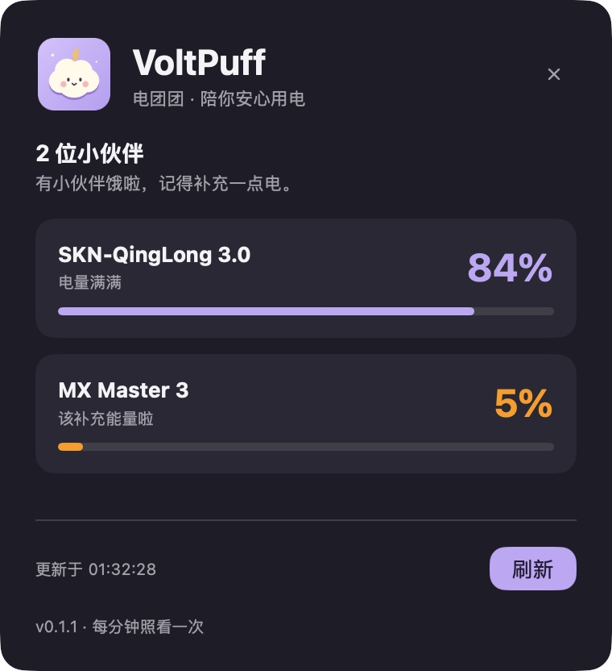

# VoltPuff · 电团团


一只住在 macOS 菜单栏里的小团子，帮你照看键盘、鼠标等外设的电量。

使用 [MyGo](https://github.com/egoist/mygo) 原生 UI 和 Go 编写。



## 下载与使用

从 [Releases](https://github.com/knothhe/VoltPuff/releases/latest) 下载 Universal DMG 或 ZIP，支持 Apple Silicon 和 Intel Mac，系统要求 macOS 13 或更新版本。

打开 DMG，将 **VoltPuff.app** 拖进「应用程序」，然后启动。首次启动只显示菜单栏图标，不主动弹出面板，也不显示 Dock 图标；点击菜单栏的小团子才会展开电量面板。

- 点击小团子，查看设备名称、电量和充电状态。
- 菜单栏显示当前设备中的最低电量；20% 及以下的设备显示暖色提示。
- 每分钟自动刷新，打开面板时也会刷新，还可以点击「刷新」。
- 右上角「×」、点击面板之外、Escape 和 Command-W 都只收起面板，程序继续在菜单栏运行。只有右键菜单中的「退出电团团」或 Command-Q 才会结束程序。
- 右键图标可以打开面板、刷新或退出。
- 单实例运行，避免创建多个菜单栏图标。

### 首次安装：移除下载隔离属性

当前发布包使用固定的本地证书签名，**没有 Apple Developer ID 签名和公证**，macOS 可能提示无法验证开发者或阻止打开。

确认应用来自[本仓库的 Releases](https://github.com/knothhe/VoltPuff/releases)，并把 `VoltPuff.app` 拖入「应用程序」后，在终端执行：

```sh
xattr -dr com.apple.quarantine /Applications/VoltPuff.app
open /Applications/VoltPuff.app
```

此命令只移除这个应用的下载隔离属性。也可以通过「系统设置 → 隐私与安全性 → 仍要打开」允许启动，或从源码构建。

应用的固定 Bundle ID 为 `voltpuff.knothhe.com`。

## 电量来源

VoltPuff 每次只执行 macOS 自带的只读命令：

```sh
/usr/bin/pmset -g accps
```

只显示 **macOS 已经报告的配件电源**，不扫描蓝牙、不配对设备、不需要辅助功能权限，也不打开系统设置。既不联网，也不上传设备名称或电量。

设备必须向 macOS 报告电量才能显示。没有读数的设备不会被当成 0%；没有设备时显示空状态，读取失败时明确标记上次结果。显示的是系统最近报告的数值，实际更新频率取决于设备。`accps` 的输出属于系统实现细节，未来 macOS 版本可能需要适配。

首次验证使用 SKN-QingLong 3.0 和 Logitech MX Master 3。

## 构建

需要 Go **1.27.1+**、macOS，以及 Xcode Command Line Tools。MyGo 固定为 **v0.6.3**。无需 Node.js、Bun 或浏览器。

```sh
make run      # 开发运行
make check    # 测试、格式与 go vet
make build    # Universal .app 和 .dmg → build/darwin-universal/
make release  # DMG、ZIP 和 SHA256SUMS → dist/
```

`make release` 会先检查代码，再构建 Apple Silicon / Intel 通用应用并生成校验文件。

默认固定使用 `mygo.json` 中的本地代码签名证书：`Knothhe Local Code Signing`，证书 SHA-1 为 `E10DFA9F3B6BA09808805116D499256837FD8EF4`；不向仓库提交私钥或证书。

其他开发者没有这个证书时，可使用 `make build SIGN=-` 或 `make release SIGN=-` 做 ad-hoc 构建，也可以用 `SIGN="自己的签名身份"` 指定证书。

运行 `make icons` 可重新生成图标；原始绘图代码位于 `internal/artwork`。

也可以通过命令行使用相同的读取逻辑：

```sh
go run . -show       # 显式展开面板；默认启动仅显示菜单栏图标
go run . -list       # JSON，不启动图形界面
go run . -version
# 打包后：
./build/darwin-universal/VoltPuff.app/Contents/MacOS/VoltPuff -list
```

## License

[MIT](LICENSE)
